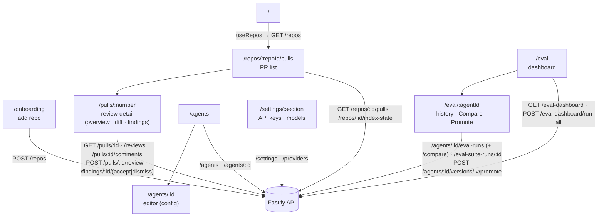

# `@devdigest/web` — the studio (Next.js 15)

The DevDigest UI: import repos, browse pull requests, run and read AI reviews,
and author agents. App Router + React Server/Client components, data via
**TanStack Query** hooks over the Fastify API. (This is the starter surface;
course lessons add the Skills, Memory, Eval, Blast/Brief, multi-agent, CI, and
dashboard screens.)

- **Stack:** Next.js 15 (App Router), React 19, TanStack Query, `next-intl`
  (messages in `messages/<locale>/*.json`), `recharts`, `mermaid`,
  `react-markdown`. Styling is Tailwind CSS v4 (configured in
  `src/app/globals.css`) with shadcn/ui primitives in `src/components/ui`;
  shared Zod contracts are vendored under `src/vendor/shared`
  (`@devdigest/shared`). Settings → Appearance switches theme (dark/light),
  palette (Classic/Stone) and accent colour.
- **API base:** `NEXT_PUBLIC_API_BASE` (default `http://localhost:3001`), used by
  `src/lib/api.ts`. Every data hook lives in `src/lib/hooks/*`.
- **Run:** `pnpm dev` (`:3000`). **Test:** `pnpm test` (vitest + jsdom, fetch
  mocked — no API needed). **Typecheck:** `pnpm typecheck`.
- **Desktop build:** `NEXT_OUTPUT=standalone NEXT_PUBLIC_API_BASE=http://127.0.0.1:43101 pnpm build`
  emits `.next/standalone/server.js` (with `messages/` traced in), which the
  Electron app (`../desktop`) runs. Without `NEXT_OUTPUT` the build is the usual
  `next start` one.

## UI route map

Routes (`src/app/**/page.tsx`) and the API surface each leans on (via
`src/lib/hooks/*` → `src/lib/api.ts`):

Finding cards on the PR page also call `POST /findings/:id/eval-case` ("Turn
into eval case") and `POST /findings/:id/reply` ("Reply to author"); "Learn" is
a disabled "Coming soon" placeholder. The agent editor's Evals tab manages cases
and starts runs. Specs: [`specs/agent-evals.md`](specs/agent-evals.md).

Cross-cutting chrome lives in `src/components/app-shell` (nav, breadcrumbs,
`g`-then-key shortcuts). Pages are thin; feature logic sits in colocated
`_components/<Name>/` folders, each with its own `*.test.tsx`.

## Testing

Component/interaction tests (`*.test.tsx`) run under vitest + jsdom with `fetch`
mocked, so they need neither the API nor a browser. The real browser journeys
(client + API + seeded DB) are covered by the deterministic agent-browser suite
in [`../e2e`](../e2e/README.md) and the `e2e-web.yml` workflow. See
[`../TESTING.md`](../TESTING.md).
