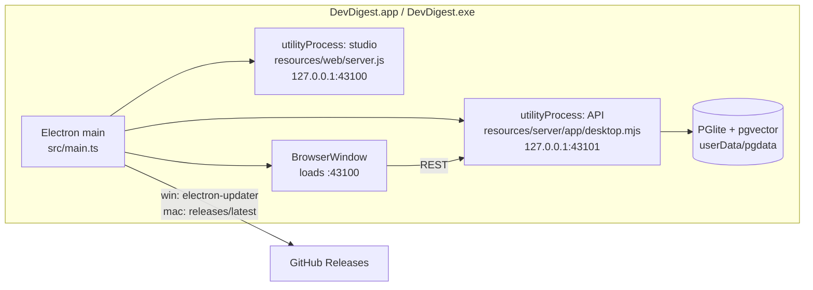

# desktop/ — DevDigest desktop app (`@devdigest/desktop`)

Electron shell that ships DevDigest as an installable app for **Windows** and
**macOS**. No Docker, no terminal: the API runs on an embedded PGlite database,
the studio is the Next.js standalone build, and both run inside the app.

| Platform | Artifact | Updates |
|----------|----------|---------|
| Windows x64 | `DevDigest-Setup-<v>.exe` (NSIS, per-user) | **automatic** — electron-updater downloads from GitHub Releases, installs on restart |
| macOS arm64 | `DevDigest-<v>-arm64.dmg` | manual — the app says a new version exists and opens the Releases page |

Both builds are **unsigned** (no paid certificates), so first launch shows a warning:

- **Windows** SmartScreen: *More info → Run anyway*.
- **macOS** Gatekeeper: right-click the app → *Open* (or
  `xattr -dr com.apple.quarantine /Applications/DevDigest.app`).

Users need **Git** installed (repos are cloned with the system `git`). The app
warns on startup if it's missing.

## Architecture



- **Startup:** single-instance lock → splash → preflight (ports 43100/43101
  free, `git` present) → fork API + studio → wait for `/health/ready` and
  `/` → open the window.
- **Shutdown:** the API gets a `shutdown` message over `parentPort` so PGlite
  closes its data dir cleanly (on Windows `kill()` would terminate it outright),
  then the studio is killed. The same path runs before an auto-update installs.
- **Ports are fixed** because the studio's API base is inlined at client build
  time (`NEXT_PUBLIC_API_BASE=http://127.0.0.1:43101`).
- **Data** lives in the OS app-data folder (`%APPDATA%\DevDigest`,
  `~/Library/Application Support/DevDigest`): `pgdata/`, `workspace/` (clones),
  `secrets.json` (keys from Settings), `logs/` (`main.log`, `api.log`, `web.log`).
  *Help → Open Data Folder / Open Logs Folder* opens them.

## Build locally

```sh
# 1. API bundle (server/)
cd server && pnpm install && pnpm bundle:desktop
# 2. studio standalone build (client/)
cd ../client && pnpm install
NEXT_OUTPUT=standalone NEXT_PUBLIC_API_BASE=http://127.0.0.1:43101 pnpm build
# 3. desktop
cd ../desktop && pnpm install
pnpm stage   # copies both into resources/, installs the API's natives for this OS
pnpm start   # run unpackaged (data in DevDigest-dev, not the installed app's)
pnpm dist    # build the installer into release/ (no publishing)
```

Re-run `pnpm stage` after rebuilding the server or the client.

## Release

Nothing to bump by hand — the version comes from the tag:

```sh
git tag v0.2.0
git push origin v0.2.0
```

`.github/workflows/release.yml` then creates a draft release, builds Windows
and macOS on their own runners (native modules are per-OS), uploads the
installers + `latest.yml` into the draft, and publishes it. Tags with a dash
(`v0.3.0-beta.1`) become pre-releases, which installed apps don't auto-update to.
Running the workflow manually (*Actions → release → Run workflow*) is a dry run:
it builds both platforms and attaches the installers as workflow artifacts.
