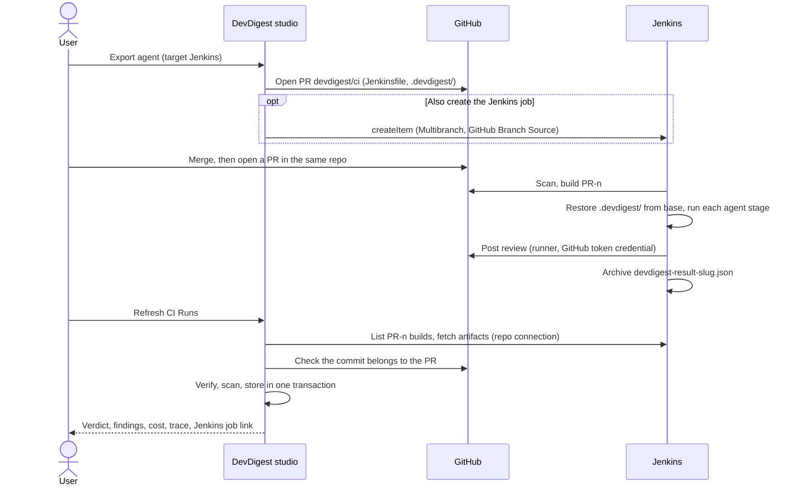

# Export an agent to Jenkins

Run one of your DevDigest review agents on every pull request through a
Jenkins **Multibranch Pipeline**. The repository stays on GitHub: DevDigest
opens one pull request (`devdigest/ci`) that adds a `Jenkinsfile` plus the
agent's manifest, skills, memory and bundled runner. Jenkins builds each PR,
the runner posts the review to the GitHub PR, and the studio pulls the
results into **CI Runs**.

The GitHub Actions variant is described in
[`export-agent-to-github-actions.md`](export-agent-to-github-actions.md). A
repository uses one CI target: exporting a Jenkins agent to a repo that already
has GitHub Actions agents (or the other way round) is refused with
`ci_target_conflict`.

Specs: [`server/specs/ci.md`](../server/specs/ci.md) (AC-46 – AC-86) and
[`client/specs/agent-ci.md`](../client/specs/agent-ci.md) (AC-35 – AC-53).

## Prerequisites

- The repository is imported in DevDigest, and the GitHub token saved in
  **Settings** can push a branch and open a PR (classic PAT `repo`; no
  `workflow` scope is needed because nothing under `.github/workflows/` is
  committed).
- Jenkins with the plugins **Pipeline**, **Pipeline: Multibranch**,
  **Pipeline: Declarative**, **GitHub Branch Source**, **Credentials Binding**
  and **Git**.
- Node.js 20 or newer on the PATH of the agents the job runs on.
- Three Jenkins credentials (IDs are configurable in the wizard):

  | Default ID | Kind | Used for |
  |---|---|---|
  | `devdigest-openrouter-api-key` | Secret text | The OpenRouter key the review calls |
  | `devdigest-github-token` | Secret text | Reading the PR, posting the review, fetching `.devdigest/` from the base branch |
  | `devdigest-github-scan` | Username with password (GitHub user + token) | GitHub Branch Source scanning (only if DevDigest creates the job) |

## Connect the repository to Jenkins (optional, recommended)

The Jenkins connection is **per repository**. Open it from the wizard's
Configure step (**Jenkins server → Connect Jenkins**), from a Jenkins row on the
agent's CI tab, or from a sync error on CI Runs.

- **URL**: `http(s)://host[:port][/path]`, no credentials or query string.
- **Username** and **API token** (Jenkins → your user → Security → API Token).
  The token is stored on this machine through the secrets store, never in the
  database, and never shown again; leave it blank to keep the saved one.
- **Test connection** checks the URL and credentials and shows the Jenkins
  version and user. It writes nothing.
- **Remove** deletes the connection and its token. Installations and runs
  stay; those agents stop syncing until you connect again.

Without a connection you can still export; you just cannot create the job from
DevDigest, validate edited Jenkinsfiles against Jenkins, or sync results.

## Steps

1. **Export.** Open the agent → **CI** tab → **Add to CI** → target
   **Jenkins**.
2. **Preview.** Review the generated `Jenkinsfile` (editable) and the
   read-only `.devdigest/` files. An edited Jenkinsfile is linted when you
   continue (see *Security model*); with a connection it is also checked by
   Jenkins' declarative validator.
3. **Configure.**
   - **Triggers**: `opened` and/or `synchronize` (see *Trigger limits*).
   - **Multibranch job**, **credential IDs** and **agent label**. These are
     shared by every Jenkins agent on the repository: changing them for one
     agent rewrites the Jenkinsfile and the stored settings of the others
     (the preview warns you).
   - **Post results as**: GitHub review, PR comment, or exit code only.
4. **Install.** Open the PR (or download a zip). Tick **Also create the
   Jenkins job** to have DevDigest create the Multibranch Pipeline through the
   Jenkins API with: GitHub Branch Source on this repo (scan credential), PR
   discovery from origin only with "The current pull request revision", no
   branch or fork discovery, script path `Jenkinsfile`, periodic scan every
   hour. An existing job is never changed. If job creation fails, the PR is
   still opened and the reason is shown.
5. **Create the credentials** listed in the PR body, review the PR and merge
   it. The export PR's own build skips the review (the runner is not on the
   base branch yet) and syncs as `artifact_missing`, which is expected.
6. **Open a PR in the same repository.** Jenkins finds it on its next scan
   (webhooks usually cannot reach a local Jenkins; press **Scan Repository
   Now** to skip the wait) and builds `PR-<n>`.
7. **Gate merges.** Set **Fail CI on** on the CI tab so the stage fails on
   findings, then require the Jenkins commit status check in the repo's
   GitHub branch protection.
8. **Refresh CI Runs** to pull finished builds into the studio.

## Trigger limits

Jenkins does not tell a build why it started. DevDigest classifies build **1**
of a `PR-<n>` job as `opened` and every later build as `synchronize`; each
agent's stage only runs for its own triggers, and sync skips the builds a
stage skipped.

- A manual rebuild or replay counts as `synchronize`.
- `reopened` is not available: Jenkins does not rebuild a reopened PR without
  new commits, and a reopen counts as `opened` only if Jenkins had already
  deleted the PR job.

## Security model

- Fork PRs never run: the generated job does not discover forks, and every
  stage also skips builds with `CHANGE_FORK` set. The runner refuses fork PRs
  a third time.
- Before any agent stage, the build replaces `.devdigest/` with the copy from
  the base branch (`origin/$CHANGE_TARGET`, authenticated with the GitHub token
  credential), so a PR cannot swap the runner or a manifest.
- Secrets are bound only with `withCredentials` and used as shell variables
  inside single-quoted `sh '''…'''` strings; nothing is Groovy-interpolated
  into a shell command.
- Edited Jenkinsfiles are linted as text (never evaluated). Rejected: missing
  fork guard, base restore, credential bindings, trigger guards, archive or
  timeout; credentials used outside `withCredentials`; `"…${…}"` shell
  strings; `script {}`, `load`, `evaluate`, `@Grab`, shared libraries,
  scripted `node()`; setting `NODE_OPTIONS`, `LD_PRELOAD`, `LD_LIBRARY_PATH`,
  `BASH_ENV`, `ENV` or `PATH`.
- **Same-repo PRs can still edit the `Jenkinsfile`.** GitHub Branch Source's
  "Trust" setting only governs fork PRs; for same-repo PRs Jenkins runs the
  Jenkinsfile from the PR branch. Add `Jenkinsfile` and `.devdigest/` to
  CODEOWNERS and require owner review with branch protection.
- Ingest is verified: DevDigest lists builds through the repo's own
  connection, downloads `devdigest-result-<slug>.json`, scans it for secrets
  (including stored Jenkins tokens), and accepts it only if the job, PR
  number, build number, repository id/name, agent slug match Jenkins and the
  installation, and the commit is part of the PR according to GitHub.
- Jenkins calls use a 10-second timeout, send credentials only to the saved
  origin, never follow a redirect to another host and never follow URLs found
  in Jenkins responses.

## How it fits together

Refreshing again never duplicates a run: each build is stored once, keyed by
PR, build number and start time.

## Sync errors

When an installation cannot be synced, the others still are. CI Runs and the
agent's CI tab show the reason and a fix:

| Code | Meaning | Fix |
|---|---|---|
| `jenkins_not_configured` | The repository has no Jenkins connection | Connect Jenkins |
| `jenkins_connection_mismatch` | The connection points to a different server than the one the agent was exported to | Point it back, or re-export |
| `jenkins_auth_failed` | Jenkins rejected the username or API token | Edit the connection |
| `jenkins_unreachable` | Network error, timeout or 5xx | Check Jenkins and the URL, then Refresh |
| `jenkins_job_not_found` | The multibranch job does not exist | Create it, or re-export with the right job name |

Saving or removing a connection lets you Refresh again immediately.

## Known data loss

- When a PR is closed, Jenkins deletes its `PR-<n>` job; builds not synced
  before that are gone.
- The build discarder keeps the last 50 builds' artifacts; a discarded
  artifact syncs as `artifact_missing`.

## Try it locally

[`docker/jenkins/README.md`](../docker/jenkins/README.md) starts a ready Jenkins
(Node 22, plugins, credentials via JCasC) with
`docker compose --profile jenkins up -d --build jenkins`.
