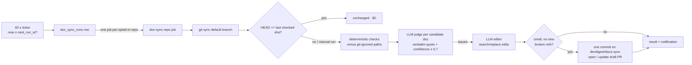

# Docs Sync — nightly documentation drift check

Status: **draft** — Phases 1–3 implemented (scheduler, settings, Run now,
deterministic checks, LLM judge/editor, draft docs PR, diagrams, dismissal
memory, desktop keep-awake). Real-GitHub PR creation and the desktop
keep-awake are not yet verified end to end. Client side: Settings → **Docs sync**
(`client/src/app/settings/[section]/_components/SettingsView/_components/SettingsDocSync/`).

## Goal

While DevDigest is open, once per scheduled time it walks every opted-in repo,
finds documentation that no longer matches the code, and opens or updates a
single **draft** pull request per repo with minimal doc fixes. It never merges.



## Phases

1. **Scheduler + settings + Run now + deterministic checks** (AC-1…AC-11).
2. **LLM judge → editor → validation → one draft PR per repo** (AC-12…AC-18).
3. **Diagrams, dismissed suggestions, desktop keep-awake** (AC-19…AC-22).

## Decisions

- The scheduler lives in the API process, so it runs in the desktop app and in
  `./scripts/dev.sh` alike — "app is open" is the only precondition. It never
  wakes a sleeping machine.
- A 60 s ticker compares `now ≥ next_run_at` (persisted). No long `setTimeout`
  — survives sleep, restarts and clock changes.
- Repos are **opt-in** (`repos.doc_sync_enabled`, default false).
- Missed run (app closed / machine asleep at the scheduled time): runs once on
  the next tick if within **6 h** of the scheduled time, otherwise skipped and
  the next occurrence is scheduled. Missed runs never pile up.

## Schedule model

One row per workspace (`doc_sync_schedules`):

| field | meaning |
|---|---|
| `enabled` | master switch |
| `time` | `HH:mm`, wall-clock in `timezone` |
| `days` | ISO weekdays 1–7; empty = every day |
| `repeat` | false = run once, then `enabled` turns off |
| `timezone` | IANA zone from the browser |
| `next_run_override` | "next run only at …" — wins over the rule once, then cleared |
| `next_run_at` | server-computed, never client-written |
| `last_run_at` | start of the last run (scheduled or manual) |

## Acceptance criteria

- **AC-1** `GET /doc-sync/schedule` returns the workspace schedule (defaults:
  disabled, `02:00`, every day, repeat on, `UTC`) with `next_run_at`.
  *Verify: API call on a fresh DB.*
- **AC-2** `PUT /doc-sync/schedule` validates `time` (`HH:mm`), `days` (1–7),
  `timezone` (valid IANA) → 422 otherwise, and recomputes `next_run_at`
  (override if set and in the future, else the next rule occurrence; null when
  disabled). *Verify: API call.*
- **AC-3** `next_run_at` honours the timezone including DST transitions.
  *Verify: helper check.*
- **AC-4** When `now ≥ next_run_at` and within the 6 h catch-up window, the
  ticker starts one run (`trigger = scheduled`); past the window it only
  advances `next_run_at`. After a run `next_run_override` is cleared, and with
  `repeat = false` the schedule is disabled. *Verify: manual / log.*
- **AC-5** `POST /doc-sync/run` starts a run now (`trigger = manual`); 409
  `doc_sync_in_progress` while another run of the workspace is `running`; 422
  `no_repos` when no opted-in repo has a clone. *Verify: API call.*
- **AC-6** A run enqueues one job per opted-in cloned repo (15 min timeout, no
  retries). Each job syncs the clone to the default branch (skipped — current
  tree checked as-is, and no PR — while Project Context has uncommitted doc
  edits there, same guard as repo-intel resync). A **scheduled** run whose HEAD
  equals the last checked sha stores `unchanged` and does nothing else ($0); a
  **manual** run always re-checks. A job never throws. *Verify: run on a real repo.*
- **AC-7** Deterministic checks over documentation files (root `*.md`, any
  `README*.md`/`AGENTS.md`, everything under `docs/`; skipping generated,
  vendored and fixture folders and historical records — `plans/`, `retro(s)/`,
  `adr(s)/`, `decisions/`, `archive/`, `CHANGELOG`), tuned for precision:
  - broken relative links (links escaping the repo are skipped — they point at
    GitHub pages);
  - backticked paths (file with a word-like extension, or `dir/`) that exist
    nowhere — relative to the doc, the root, or as a suffix of any repo path
    (module-relative paths); build output and dot-paths are ignored;
  - `pnpm|npm|yarn run <script>` (or a bare `pnpm <name>` when the name
    contains `:` or is a common script such as `dev`/`build`/`test`) with no
    such script in any `package.json` of the repo.

  Link/path findings that `.gitignore` matches (`git check-ignore --no-index`)
  are dropped — runtime/build output is absent by design.
  *Verify: run on this repo — 5 findings over 49 docs, no noise from plans.*
- **AC-8** When the last job finishes the run is `done` (or `failed` if every
  repo failed) and one notification (`kind = doc_sync`) summarises it.
  *Verify: notification center.*
- **AC-9** Runs left `running` by a dead process are marked `failed` on boot.
  *Verify: restart during a run.*
- **AC-10** `GET /doc-sync/runs` returns the latest runs with per-repo results;
  `GET /doc-sync/repos` lists repos with `enabled`, last checked sha/time;
  `PATCH /repos/:id/doc-sync` toggles a repo. *Verify: API call.*
- **AC-11** The ticker does not start under `NODE_ENV=test`.

### Phase 2 — LLM review and the docs PR

- **AC-12** LLM candidates per repo: docs with deterministic findings first,
  then docs related to files changed since the last checked sha (the doc
  mentions the path from the root or its folder, or — for a deleted/moved file
  — it is the README/AGENTS of a folder that contained it); at most 8 docs,
  each ≤ 40 000 chars. No candidates → no LLM call. The model is the
  `doc_sync` feature model (Settings → Feature Models).
- **AC-13** Judge (structured): returns `{claim, problem, evidence,
  confidence}`. An issue is kept only when `confidence ≥ 0.7` **and** `claim` is
  a verbatim substring of the doc (grounding). Evidence sent: changed-file list,
  per-file diffs for related files, deterministic findings with same-basename
  path candidates.
- **AC-14** Editor (structured): returns `{find, replace}` edits for the kept
  issues only. Each `find` must occur exactly once (else that edit is
  skipped). The edited doc is accepted only when ≥ 1 edit applied, it changes
  ≤ 60 lines, and re-running the AC-7 checks finds nothing new. An issue is
  `fixed` when its claim is gone from an accepted doc.
- **AC-15** Docs are read with LF line endings (as stored on GitHub), so
  quotes/edits match on a Windows clone and the PR commits LF.
- **AC-16** PR: accepted docs are committed as ONE commit on
  `devdigest/docs-sync`, parented on the default branch's tip (force-moved),
  and an open PR on that branch is updated (title/body) or a **draft** PR is
  opened. Never merged. Skipped with `pr_action = failed` when the clone isn't
  at the default branch's tip on GitHub; `branch_moved` when the branch tip is
  not the commit DevDigest pushed last (`repos.doc_sync_branch_sha`).
- **AC-17** PR body: one table row per fixed issue (file · was · now), the
  count of deterministic findings left unfixed, a short review checklist, and
  a note that the next run updates the PR in place.
- **AC-18** The run result stores issues, docs updated, PR url/action/error
  and LLM cost; Settings → Docs sync shows them, and the notification says
  "Docs PR ready" when a PR was opened or updated. LLM/GitHub failures never
  fail the repo's deterministic result.

### Phase 3 — diagrams, dismissed suggestions, keep-awake

- **AC-19** The editor may fix an existing Mermaid diagram, or add **one** new
  diagram per doc when the section it is fixing describes a multi-step flow or
  connected components and has none. Every added/changed ```` ```mermaid ````
  block must pass `validateMermaid`: a strict subset (`flowchart`/`graph`
  with plain nodes, edges, edge labels and subgraphs, or a basic
  `sequenceDiagram`), ≤ 30 lines and ≤ 15 nodes, no styling, `click`, HTML or
  `%%{init}`. If any fails, the doc is re-applied without the edits that touch
  diagrams (text fixes are kept). No Mermaid runtime is used — the subset is
  what can be checked without a DOM.
- **AC-20** When the docs PR DevDigest opened is closed **without merging**,
  the next run moves its claims (`repos.doc_sync_pr_claims`) into
  `repos.doc_sync_dismissed`; the judge's issues matching a dismissed
  (path, claim) are dropped. A merged PR just clears the pending claims.
  GitHub being unreachable keeps the lists as they are.
- **AC-21** Settings → Docs sync shows "N suggestions … won't be proposed
  again" per repo with **Allow again**
  (`PATCH /repos/:id/doc-sync { clear_dismissed: true }`).
- **AC-22** `GET /activity` reports `docs_running`; the studio counts it in the
  desktop activity and sends `keepAwake`, and the desktop main process holds a
  `powerSaveBlocker('prevent-app-suspension')` only while it is true. It never
  wakes a sleeping machine.

## Untrusted input

Repository content is untrusted. Files are read only inside the clone (paths
normalised, links escaping the repo skipped, symlinks not read). Prompts wrap
docs/diffs in tags and tell the model they are data. Writes are limited to
documentation files that were candidates (AC-7 doc set), via validated
search/replace edits — the model never chooses a path to write.
